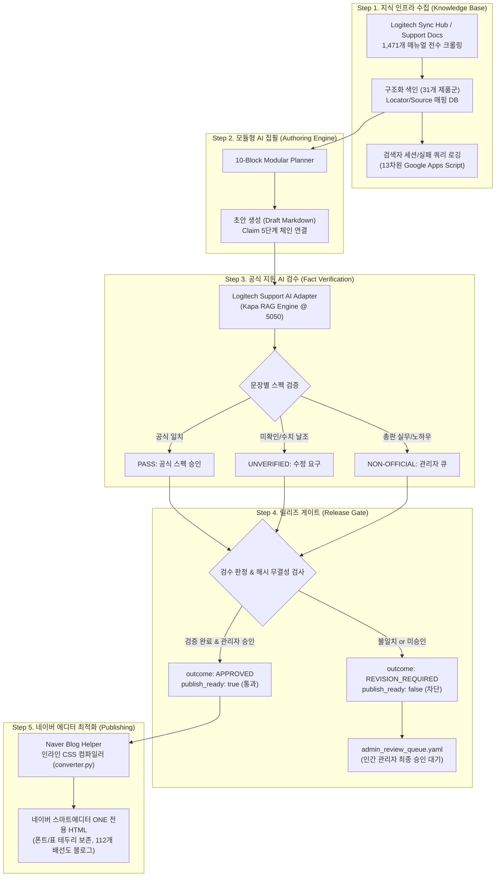

# Logi-Content-System: 공식 근거 기반 AI 기술 콘텐츠 생성·검수 파이프라인

[](https://www.python.org/downloads/release/python-3110/)
[](https://docs.pytest.org/)
[]()
[]()

> **"LLM의 생성 속도와 엔터프라이즈 하드웨어 기술문서의 100% 무결성을 결합하다."**  
> 고가 B2B 화상회의 장비(로지텍 VC 솔루션)의 공식 매뉴얼 1,471건을 색인화하고, **문장 단위 팩트체크(Kapa RAG) 및 엄격한 릴리즈 게이트(Release Gate)**를 통해 AI 환각(Hallucination)을 원천 차단하는 엔드투엔드(End-to-End) 콘텐츠 생성·검수 시스템입니다.

---

## 🎯 1. 해결하고자 한 문제 (Problem Definition)

B2B 하드웨어 기술 문서는 펌웨어 버전(CollabOS), 플랫폼(Zoom Rooms, MS Teams), 룸 규모에 따라 지원 조건이 엄격하게 달라집니다. 기존 범용 LLM을 기술 원고 작성에 도입했을 때 다음과 같은 **치명적인 환각 및 왜곡 현상**이 발생했습니다:

1. **스펙 혼동 (Cross-Device Hallucination)**: Rally Bar Mini의 사양이 상위 기종인 Rally Plus의 사양과 뒤섞이거나 없는 하드웨어 포트가 언급됨.
2. **엔지니어링 개념 왜곡**: 화자추적카메라(RightSight 2)의 광학 유효 거리(1.0~4.5m)를 본체 마이크 수음 반경(7.0m)으로 잘못 설명하여 고객사 현장 구축 시 심각한 시공 하자 유발.
3. **비공식 수치 날조**: 공식 데이터시트에 없는 소수점 단위의 화각(HFOV 82.1°, VFOV 52.2°)이나 마이크로초(μs) 연산 등 그럴듯한 허위 공학 수치를 생성.
4. **상업성 문구와 기술 사실의 뒤섞임**: 제조사 공식 보증 스펙과 총판사의 실무 시공 노하우/영업 링크가 본문 내에 혼재되어 신뢰도 하락.

---

## 🏗️ 2. 전체 시스템 아키텍처 (System Architecture)

본 시스템은 **"공식 근거 확보"**와 **"원고 집필"**을 물리적으로 분리하고, 집필된 모든 문장을 **"제조사 Support RAG 검수"**와 **"SHA-256 기반 릴리즈 게이트"**로 검증하는 5단계 파이프라인으로 구성됩니다.



---

## 🛡️ 3. 핵심 엔지니어링 메커니즘 (Key Highlights)

### ① 5단계 지식 추적 체인 (Claim-to-Locator Lineage)
원고의 모든 문장은 단독으로 존재하지 않고 원천 문서의 위치까지 5단계로 추적 가능하도록 역추적 메타데이터를 유지합니다:
$$\text{Claim (원고 주장)} \rightarrow \text{Knowledge Pack} \rightarrow \text{Fact (정형화된 사실)} \rightarrow \text{Source (공식 문서)} \rightarrow \text{Locator (문서 내 앵커/헤딩)}$$

### ② 3계층 서술 분리 (Layered Writing Strategy)
문장의 성격에 따라 엄격한 메타데이터 태그를 부여하여 AI 환각과 주관적 해석을 격리합니다:
* `[FACT]`: 제조사 공식 문서(Kapa RAG)에서 100% 입증된 순수 하드웨어 스펙.
* `[LIMITATION]`: 룸 규모(15인 이상)에 따른 물리적 한계 및 감쇠 특성 고지.
* `[INTERPRETATION]`: 총판사 테크니컬 랩의 현장 실증 테스트 및 시공 노하우 (관리자 승인 필수).

### ③ SHA-256 기반 무결성 릴리즈 게이트 (`services/article_approval.py`)
* 원고 텍스트의 SHA-256 다이제스트를 생성하여 승인 시점의 해시와 발행 시점의 해시가 **1글자라도 다르면 즉시 발행을 거부(`publish_ready: false`)**.
* 공식 AI 검수에서 미검증 항목이 발견되면 자동으로 `admin_review_queue.yaml`에 티켓을 발급하고 관리자의 명시적 승인 전까지 다음 단계 진입을 원천 차단.

### ④ 네이버 스마트에디터 ONE 전용 인라인 CSS 컴파일러 (`naver_helper/`)
네이버 블로그 에디터의 외부 CSS 제거 특성을 역공학(Reverse Engineering)하여 해결:
* **폰트 보존**: 모든 태그에 `style="font-family: '나눔고딕', NanumGothic, sans-serif;"` 인라인 강제 주입.
* **무한 가로줄 버그 방지**: `<hr>` 태그 복사 시 가로선이 화면 끝까지 증식하는 에디터 버그를 해결하기 위해 **물리적 여백 블록(`<div style="height: 64px;"></div>`)**으로 전면 치환.
* **표(Table) 테두리 누락 방지**: 모든 `th`, `td` 엘리먼트에 `border: 1px solid #d4d4d8;`를 개별적으로 인라인 주입하는 Full Grid 컴파일러 구현.

---

## 🔍 4. 대표 원고 검수 및 전후 수정 실증 사례 (`CNT-2026W39-001`)

* **원고 주제**: 화자추적카메라의 원리와 로지텍 RightSight 2 기술 실무 가이드 (Rally Bar & Zoom Rooms)
* **산출물 위치**: `samples/CNT-2026W39-001/`

| 검증 항목 ID | 초안 (Draft) 작성 내용 | Kapa RAG 공식 검수 결과 | 최종본 (Final) 조치 결과 |
| :--- | :--- | :--- | :---: |
| **AI-SPEC-01** | Group View(전원 프레이밍), Speaker View(화자 클로즈업 + PiP), Grid View(타일 분할) | **PASS**: 로지텍 공식 백서 및 CollabOS 릴리즈 노트와 100% 일치 | **원문 보존** |
| **AI-SPEC-02** | Group View 최대 7.0m, Speaker View 1.0~4.5m, Grid View 최대 6.0m | **PASS**: 로지텍 공식 거리 가이드 테이블 수치와 완벽 일치 | **원문 보존** |
| **AI-FLAG-01** | 메인 카메라 DFOV 90°, HFOV 82.1°, VFOV 52.2°, 팬 ±25°/틸트 ±15°, 15배 줌... AI 뷰파인더 174° | ⚠️ **UNVERIFIED**: 공식 지원 지식 소스에 소수점 각도 근거 없음 | **해당 수치 단락 영구 삭제 및 물리적 음향 배치 가이드로 전면 대체** |
| **AI-FLAG-02** | 마이크로초(μs) 단위의 도달 시간 차이(TDoA) 삼각측량 연산 | ⚠️ **UNVERIFIED**: 일반 공학 용어이나 로지텍 공식 표현과 불일치 | **'마이크로초' 단어 삭제 및 공식 센서 퓨전 표현으로 정제** |
| **AI-FLAG-03** | 본문 중간 오우션테크놀러지 쇼룸 실증 언급 및 B2B 견적 할인 링크 | ⚠️ **NON-OFFICIAL**: 제조사 공식 지식 범위를 벗어난 마케팅 콘텐츠 | **본문에서 분리하여 맨 끝단 공식 비즈니스 배너 블록으로 격리 재배치** |

---

## 🧪 5. 테스트 스위트 및 신뢰성 검증 (Verification Suite)

본 시스템은 파이프라인의 상태 전이, 해시 검증, 권한 격리 및 가드레일을 검증하는 **pytest 통합 테스트 스위트**를 내장하고 있습니다.

```bash
$ python -m pytest tests/test_article_approval.py tests/test_publish_gate_scenarios.py tests/test_review_pipeline_hardening.py tests/test_article_stage.py tests/test_asset_display.py tests/test_official_corrections.py tests/test_logitech_review_status.py -v
```

### 실제 실행 결과:
```text
============================= test session starts =============================
platform win32 -- Python 3.11.8, pytest-8.4.2, pluggy-1.7.0
rootdir: C:\Users\Choijay\Desktop\Logi-content-system
collected 57 items

tests/test_article_approval.py ..............                            [ 24%]
tests/test_publish_gate_scenarios.py .....                               [ 33%]
tests/test_review_pipeline_hardening.py .....................            [ 70%]
tests/test_article_stage.py .......                                      [ 82%]
tests/test_asset_display.py ....                                         [ 89%]
tests/test_official_corrections.py ...                                   [ 94%]
tests/test_logitech_review_status.py ...                                 [100%]

============================= 57 passed in 9.65s ==============================
```

* **테스트 핵심 검증 항목**:
  * `test_publish_rejects_missing_or_past_run_or_mismatched_hash`: 원고 해시 불일치 시 발행 차단.
  * `test_publish_record_rejects_pending_review_without_changing_registry`: 검수 미완료 상태에서 레지스트리 변조 시도 원천 차단.
  * `test_empty_official_claims_cannot_advance_to_images`: 공식 Claim 검증 없이 이미지/발행 단계 진입 방지.
  * `test_malformed_interpretation_blocks_approval_and_export`: 3계층 서술 태그 규격 위반 시 내보내기 거부.

---

## 📂 6. 디렉토리 구조 (Repository Layout)

```
Logi-content-system/
├── README.md                      # 전체 시스템 아키텍처 및 검증 보고서
├── .env.example                   # 환경설정 템플릿 (보안 마스킹 완료)
├── .gitignore                     # 바이너리, 로그, 대용량 크롤링 원본 제외
├── requirements.txt               # 의존성 패키지 목록
│
├── crawler/                       # 매뉴얼 자동 수집 파이프라인 (Logitech Quick Manual-2)
│   ├── pipeline_sync.py           # Sync Hub 크롤링 & 도구 빌드 배치
│   ├── collect_full_details.py    # 31개 제품군 카테고리별 상세 크롤러
│   └── samples/                   # 대표 기기(Rally Bar, MeetUp 2) 정제 HTML/JSON 샘플
│
├── search_logger/                 # 검색 세션 및 실패 쿼리 분석 시스템
│   └── google_apps_script/        # 13차원 검색 로그(SessionID, MissTokens, Latency) 수집 GAS
│
├── services/                      # 핵심 파이프라인 비즈니스 로직
│   ├── article_approval.py        # Release Gate 승인/차단 및 SHA-256 검증
│   ├── content_pipeline.py        # 10단계 상태 전이 파이프라인 엔진
│   ├── ask_logitech_ai.py         # Kapa RAG Support AI 통신 인터페이스
│   ├── block_authoring.py         # 모듈형 블록 기획 및 집필 검증
│   └── naver_blog_compiler.py     # 블로그 포맷팅 및 에디터 컴파일 엔진
│
├── naver_helper/                  # 네이버 스마트에디터 ONE 붙여넣기 컴파일러
│   ├── converter.py               # 인라인 CSS 자동 주입 컴파일러
│   └── inline-templates.html      # 물리적 여백 치환 및 Full Grid 테이블 템플릿
│
├── samples/                       # 대표 원고 실증 아티팩트
│   └── CNT-2026W39-001/           # 대표 원고 초안(draft), 검수보고서, 수정본(final.md)
│       ├── CNT-2026W39-001.draft.md
│       ├── CNT-2026W39-001.factcheck_kapa_rag.md
│       ├── CNT-2026W39-001.final.md
│       ├── admin_review_queue.yaml # 6개 미확인 항목 관리자 승인 대기열
│       └── verification.yaml      # 문장별 PASS/UNVERIFIED 판정 결과
│
├── content-system/                # 00_system 정책, 스키마, 룰 정의
│   └── 00_system/                 # policy, schema, rules, taxonomy
│
└── tests/                         # pytest 57+ 테스트 스위트
    ├── test_article_approval.py
    ├── test_publish_gate_scenarios.py
    ├── test_review_pipeline_hardening.py
    └── ...
```

---

## 🚀 7. 빠른 시작 가이드 (Quick Start)

### 1. 환경 설정
```bash
git clone https://github.com/tradejay/Logi-content-system.git
cd Logi-content-system
python -m venv venv
source venv/bin/activate  # Windows: venv\Scripts\activate
pip install -r requirements.txt
cp .env.example .env
```

### 2. 핵심 테스트 스위트 실행
```bash
# 릴리즈 게이트 및 파이프라인 무결성 검증
python -m pytest tests/test_article_approval.py tests/test_publish_gate_scenarios.py -v
```

### 3. 네이버 블로그 인라인 CSS 컴파일 실행
```bash
# 기존 HTML을 스마트에디터 ONE 호환 인라인 스타일로 변환
python naver_helper/converter.py samples/CNT-2026W39-001/CNT-2026W39-001.final.md
```

---

## 📜 License
This project is licensed under the MIT License.
Copyright (c) 2026 Choi Jay. All rights reserved.
