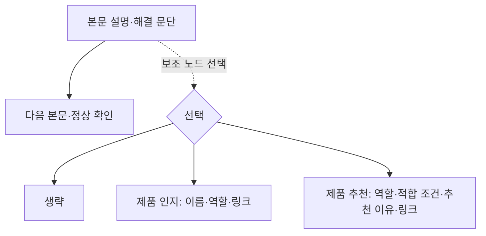

# 선택형 제품 보조 노드

본문 순서와 별도로 관리하는 선택형 구성 요소다. 선택지는 `none`(생략), `product_awareness`(제품 인지), `product_recommendation`(제품 추천)이다.

## 선택과 연결

- 사용자의 명시적 선택 → 글별 기획 선택 → 유형별 기본값 순서로 적용한다.
- 문제 해결 기본값은 제품 인지다. 기능 설명·회의실 구성·비교는 추천, 제품 소개는 중복 방지를 위해 생략을 기본 제안한다. 모든 기본값은 글별로 변경할 수 있다.
- 주제와 관련성이 없으면 생략한다. 제품 추천에는 적합한 환경·추천 이유·지원 조건이 필요하다.
- `anchor_section_id`로 본문 연결 위치를 지정한다. 보조 설명은 본문 번호에 포함하지 않고 해당 문단에서 갈라지는 노드로 표시한다.
- 배치 선택지는 두 가지다: **점검·조치 또는 본문 설명**(`body_anchor`), **다음 행동·상담**(`next_action_consultation`). 마무리에서는 답 회수·다음 행동 뒤, 상담·맺음 인사와 마지막 문의 배너 앞에 둔다. 같은 보조 설명은 선택된 위치에 한 번만 표시한다.
- 제품 인지와 추천 모두 제품의 이름·역할·사실 근거·제품 소개 링크를 연결한다. 인지 노드는 해결을 위해 구매해야 한다는 의미를 만들지 않는다.
- 근거 또는 링크가 없으면 선택을 유지한 채 미해결 항목으로 기록한다. 검증되지 않은 추천은 차단 상태로 두고 변경안을 제안한다. 자동으로 인지나 생략으로 바꾸지 않는다.
- 생략은 보조 노드만 없앤다. 본문 구성안·비교 결과에 포함된 추천을 함께 삭제하지 않는다.

## 반영 범위

여러 제품은 개수를 고정하지 않고 대안·함께 쓰는 구성·조건부 추가로 구분한다. 본문 추천과 보조 노드 추천은 같은 기획에서 관리하되, 본문에서 충분히 소개한 제품을 보조 노드에 길게 반복하지 않는다. [제품 추천 가이드](product-recommendation.md)와 `recommendation-plan.schema.json`에 제품별 역할·근거·조건·링크와 묶음 관계를 정의했다. 기존 선택 계약의 `product_ids`는 이미 배열이므로 여러 제품을 선택할 수 있다. 별도 기획 계약과 기존 선택 계약의 ID 일치 검증은 운영 연결 시 구현한다.

`companion-nodes.json`에 역할·선택·배치 규칙을 정의하고 `companion-selection.schema.json`에 선택 데이터 계약을 정의했다. catalog의 5개 템플릿과 article-plans의 20개 주제에 연결했다. 실제 예시 페이지의 보조 설명은 이전에 지정된 시연 내용으로 유지한다.

예시 페이지에는 두 배치 선택과 내용·흐름도 이동을 구현했다. 페이지의 선택은 해당 페이지 세션에서만 유지하며 운영 계획을 저장하지 않는다. 운영 파이프라인의 Planner·Writer·QA와 자동 조립기가 이 선택 계약을 소비하는 연결은 별도 구현이 필요하다.
