# Logitech 랠리 바 룸 설계 및 공간 표준 가이드 (SRC-LOGI-DOC-RALLY-BAR-GUIDE)

- **Source ID**: `SRC-LOGI-DOC-RALLY-BAR-GUIDE`
- **Vendor**: Logitech
- **Evidence Level**: E1 (제조사 공식 엔지니어링 백서)
- **최종 검증일**: 2026-09-22
- **유효 기간**: 180일 (상태: VALID)

---

# Rally Bar 상세 사용 가이드 (Port & Mode Tree)

Rally Bar의 포트 구성과 구동 모드에 따른 장비 분류 및 화면 출력 특성을 정리한 가이드입니다.

```mermaid
graph TD
    RB["Rally Bar (메인 장비)"] --> Ports["포트 구성 및 연결 대상"]
    RB --> Modes["구동 모드 및 장비 분류"]

    %% 포트 구성 섹션
    Ports --> H_Out["HDMI Out (2개)"]
    H_Out --> H_Out_Desc["회의실 전면 디스플레이 (TV/모니터)"]
    
    Ports --> H_In["HDMI In (1개)"]
    H_In --> H_In_Desc["사용자 노트북 (콘텐츠 공유용)"]
    
    Ports --> UC["USB-C (1개)"]
    UC --> UC_Desc["Room PC 또는 사용자 노트북 (USB 모드/BYOD)"]
    
    Ports --> UA["USB-A (3개)"]
    UA --> UA_Desc["주변기기 (Tap, 마우스, 키보드)"]
    
    Ports --> ET["Ethernet (1개)"]
    ET --> ET_Desc["네트워크 (유선 LAN, Sync 관리)"]
    
    Ports --> MIC["외부 마이크 포트"]
    MIC --> MIC_Desc["Rally Mic Pod / Hub / Extension"]

    %% 구동 모드 섹션
    Modes --> AppMode["Appliance Mode (안드로이드 모드)"]
    AppMode --> App_Class["분류: 올인원 비디오 협업 바"]
    AppMode --> App_Disp["화면: 듀얼 확장 (Extended) 지원"]
    AppMode --> App_Note["노트북 공유 시 콘텐츠/갤러리 분리"]

    Modes --> BYOD["BYOD/BYOM Mode (노트북 직접 연결)"]
    BYOD --> BYOD_Class["분류: USB 주변기기 모드"]
    BYOD --> BYOD_Disp["화면: 듀얼 복제 (Mirror) 만 가능"]
    BYOD --> BYOD_Note["하드웨어 단독 화면 분할 불가"]

    Modes --> USBMode["USB Mode (전용 룸 PC 사용)"]
    USBMode --> USB_Class["분류: 화상회의 카메라/오디오 시스템"]
    USBMode --> USB_Disp["화면: 듀얼 확장 (Extended) 지원"]
    USBMode --> USB_Note["디스플레이를 룸 PC에 직접 연결"]
```

---

## 1. 포트별 상세 인터페이스 (Interface)

| 포트명 | 규격 | 주요 연결 대상 | 주요 기능 |
|:---|:---|:---|:---|
| **HDMI Out** | HDMI 1.4 (2개) | TV, 모니터, 프로젝터 | 화상회의 화면 출력 (Appliance Mode 시 최대 2대) |
| **HDMI In** | HDMI 1.4 (1개) | 사용자 개인 노트북 | 프레젠테이션 및 콘텐츠 공유 (Passthrough) |
| **USB-C** | USB 3.0 Type C | Room PC, 사용자 노트북 | PC에서 카메라/마이크/스피커 장치로 인식 |
| **USB-A** | USB 2.0 Type A | Tap, 마우스, 키보드 | 시스템 설정 및 주변기기 확장용 |
| **Ethernet** | 10/100/1G | 유선 LAN 케이블 | 네트워크 연결, Sync 원격 관리, 업데이트 |
| **External Mic** | 전용 규격 | Rally Mic Pod 제품군 | 수음 범위 확장을 위한 전용 마이크 연결 |

## 2. 구동 환경별 특성 비교

### [Case 1] Appliance Mode (안드로이드 모드)
- **컴퓨팅**: 내장 CollabOS (Zoom Rooms, MS Teams Rooms 등)
- **장비 분류**: **독립형 비디오 시스템**
- **화면 구성**: **듀얼 확장(Extended) 지원**
    - 디스플레이 1: 공유 콘텐츠
    - 디스플레이 2: 참가자 비디오(갤러리 뷰)

### [Case 2] BYOD (노트북 직접 연결)
- **컴퓨팅**: 사용자 개인 노트북
- **장비 분류**: **USB 주변기기(Peripheral)**
- **화면 구성**: **듀얼 복제(Mirror) 고정**
    - 내부 프로세싱 한계로 두 개의 화면에 동일한 내용만 표시됨

### [Case 3] USB Mode (전용 룸 PC 사용)
- **컴퓨팅**: Lenovo PC, CTL Chromebox, NUC 등
- **장비 분류**: **회의실 AV 장치(AV System)**
- **화면 구성**: **듀얼 확장(Extended) 지원**
    - 디스플레이를 PC에 직접 연결하여 OS 레벨에서 확장 제어
